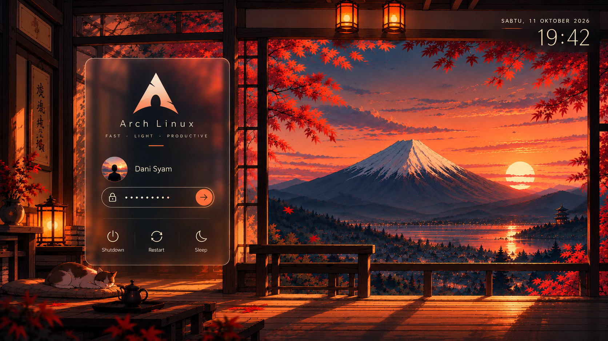

# Japanese Sunset Glass



## Install

The theme requires SDDM with a Qt 6 greeter (`sddm-greeter-qt6`) already
installed. The installer does not install packages, switch display managers,
enable or start services, or reboot. It installs the theme and updates SDDM's
theme configuration only.

Install the latest public version with:

```sh
bash -c "$(curl -fsSL https://raw.githubusercontent.com/danisyam095/sddm-japanese-sunset-glass/main/setup.sh)"
```

Review the downloaded script before running it. The command downloads the
installer over HTTPS; the installer then downloads and validates the source
archive before making changes. It asks for confirmation, backs up the existing
SDDM configuration and theme when present, and prints the backup location.
It does not restart SDDM, so apply the change only when you are ready to test
the greeter.

To install from a local checkout instead:

```sh
./install.sh
```

To show the planned paths without changing anything:

```sh
./install.sh --dry-run
```

The installer uses these defaults:

- Theme: `/usr/share/sddm/themes/sddm-japanese-sunset-glass`
- Configuration: `/etc/sddm.conf` if it exists; otherwise
  `/etc/sddm.conf.d/10-japanese-sunset-glass.conf`
- Backups: `/var/backups/sddm-japanese-sunset-glass/`

For non-standard paths, set `SDDM_THEME_ROOT`, `SDDM_CONFIG_FILE`, and/or
`SDDM_BACKUP_ROOT` before running `install.sh`.

## Uninstall

Use the backup path printed by the installer:

1. Restore the previous SDDM configuration from `<backup>/sddm.conf` to the
   configuration path printed during installation. If that backup file does
   not exist, the installer created a new configuration file; remove only that
   theme-specific drop-in file.
2. If `<backup>/theme.previous` exists, restore it to
   `/usr/share/sddm/themes/sddm-japanese-sunset-glass`. Otherwise remove only
   `/usr/share/sddm/themes/sddm-japanese-sunset-glass`.
3. Keep the backup until you have confirmed the previous SDDM theme works.

Use the actual paths from the installer output if custom paths were configured.
The installer never changes display-manager services, so uninstalling this
theme does not require changing service state.

## Rollback

If the new greeter does not look or behave correctly, restore the saved
configuration and previous theme using the backup directory above. If SDDM
cannot display a greeter, use your distribution's recovery method to switch
back to a working theme or edit the SDDM configuration from a console. Do not
delete the backup until login has been verified.

The preview mode does not test real authentication or power actions. Test the
theme on a staging system or with a non-critical account before relying on it
for production logins.
